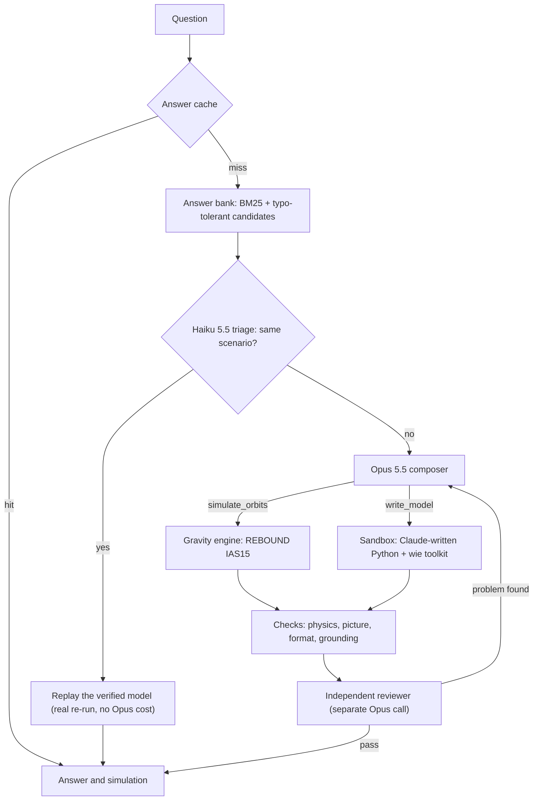

# What If Engine

**Ask the universe a what if. Watch the answer, simulated.**

Team **DoWhatExcites** (Harshil Walia, Janvhi Sharma, Abhya Garg) · Tanda AI Hackathon 2026, Brisbane

**Live:** [what-if-engine-seven.vercel.app](https://what-if-engine-seven.vercel.app) (works on phones too)

Type any physics or cosmology question ("What if the Earth spun 3,000 times faster?", "What if you fell into a black hole?", "What if a neutron star approached an Earth made of ice cream?") and the engine builds a real simulation of it, animates it in 3D, and explains it in three layers: a short plain answer, the computed results with their calculations, and a detailed explanation with the laws used.

The promise behind every answer:

> **Exact physics where the equations exist. The best supported scientific picture where they don't. Every number computed, checked, and independently reviewed.**

Claude writes the physics. Trusted numerical engines run it. Deterministic checks and a second, independent Claude reviewer try to break it before anyone sees it. Nothing is drawn or said that the computation did not produce.

---

## Contents

1. [What it does](#1-what-it-does)
2. [Repository structure](#2-repository-structure)
3. [Architecture](#3-architecture)
4. [The two simulation engines](#4-the-two-simulation-engines)
5. [The physics toolkit (wie)](#5-the-physics-toolkit-wie)
6. [Accuracy: eight layers between a question and an answer](#6-accuracy-eight-layers-between-a-question-and-an-answer)
7. [Theory tier and theory cards](#7-theory-tier-and-theory-cards)
8. [What happens to people on Earth](#8-what-happens-to-people-on-earth)
9. [Before and after](#9-before-and-after)
10. [The answer bank: instant, verified answers](#10-the-answer-bank-instant-verified-answers)
11. [The viewer](#11-the-viewer)
12. [Where AI is used, and where it deliberately isn't](#12-where-ai-is-used-and-where-it-deliberately-isnt)
13. [Literature and data](#13-literature-and-data)
14. [Technology](#14-technology)
15. [Run it](#15-run-it)
16. [Tests](#16-tests)
17. [Limitations and next steps](#17-limitations-and-next-steps)

---

## 1. What it does

Every question lands in one of four kinds, and each kind is answered honestly:

| Kind | Example | What you get |
|---|---|---|
| **Exact physics** | What if the Moon were twice as close? | A simulation from established physics (Newton, Einstein, thermodynamics, quantum mechanics, standard cosmology), with checks against known results |
| **Thought experiment** | What if the Sun were made of ice cream? | Real physics applied to an impossible premise: only what doesn't depend on unknowable details (mass, density, gravity, energy, timescales), with the guesswork labelled |
| **Theory** | What is inside a black hole? | Two to five real, published competing pictures with their proponents and an honest support level. The best supported one is simulated, and the panel says why |
| **Outside physics** | What is the mass of love? | No simulation and no invented physics: a short joke, one real fact, and a better question to try |

Each answer panel has the same shape:

1. **Answer:** two or three plain sentences, most important result first. Every number in it is traced to the computation.
2. **On Earth** (when the question touches Earth): what people would feel and see, as live gauges and a timeline of moments synced to the animation.
3. **Detailed explanation:** the laws and theories used by name, the key equations, and the calculation step by step.
4. **Computed results:** headline numbers with notes on how each was computed.
5. **Assumptions:** what the model held fixed or simplified.

The simulation first shows **today's reality**, then the **what if** happening, with a badge that flips from "Today" to "What if" at the moment of change.

## 2. Repository structure

```
what-if-engine/
├── engine/                     Python backend (FastAPI), deployed on Railway
│   ├── app/
│   │   ├── main.py             API: /ask/start, /ask/status, /simulate, /health; background jobs, rate limits
│   │   ├── spec.py             ScenarioSpec: the contract between Claude, validators, engines and the UI
│   │   ├── engines/
│   │   │   └── gravity.py      N-body engine on REBOUND IAS15 (+1PN, gravitational waves, delayed gravity, mid-run changes)
│   │   ├── sandbox/
│   │   │   ├── runner.py       Runs Claude-written models in an isolated process; scene picture checks; number grounding
│   │   │   └── wie.py          The physics toolkit models import: constants, ODE solver, benchmarked helpers, Scene builder
│   │   └── ai/
│   │       ├── composer.py     Opus writes the model or the orbit setup; checks, review and up to 3 repair rounds
│   │       ├── prompts.py      The composer's instructions: tools, tiers, toolkit, scene rules, honesty rules
│   │       ├── reviewer.py     Independent reviewer (scene and orbit), safe formula evaluator, orbit numbers, grounding
│   │       ├── earth.py        "On Earth" for orbit runs: sunlight, lagged temperature, tides, moments
│   │       ├── bank.py         Answer bank: BM25 + typo-tolerant candidates, Haiku triage, real replays
│   │       ├── cards.py        Theory card retrieval
│   │       ├── cache.py        Answer cache keyed by prompt, toolkit and model fingerprints
│   │       ├── model_spec.py   Pydantic schema for Claude's model tool input
│   │       ├── coerce.py       Repairs list fields sent as one string of tool markup
│   │       └── apiopts.py      Fast mode and effort settings, with fallback
│   ├── cards/                  23 theory cards (JSON): competing pictures with support levels and sources
│   ├── bank/entries.jsonl      The verified answer bank
│   ├── scripts/                build_bank.py (priority builds within a budget), bank_questions.py, stress tests
│   └── tests/                  101 tests: physics benchmarks, engines, sandbox, reviewer, bank, API
└── web/                        Next.js 16 frontend, deployed on Vercel
    ├── src/app/page.tsx        Landing and simulation screens, phone and desktop layouts
    ├── src/components/
    │   ├── GravityScene.tsx    3D viewer for N-body runs
    │   ├── SceneView.tsx       3D viewer for Claude-written models
    │   ├── AnswerPanel.tsx     Answer, On Earth, explanation, computed results, assumptions
    │   ├── OnEarth.tsx         Live gauges and moments for people on Earth
    │   ├── PlayRail.tsx, PhaseBadge.tsx, Timeline.tsx, SceneTimeline.tsx
    │   └── scene/              Shaders and models: planets, atmospheres, black holes, compact stars, craft
    └── public/textures/        Planet maps (Solar System Scope, CC BY 4.0) and Earth day, night and cloud maps
```

## 3. Architecture



**One contract.** Everything passes through typed schemas (`spec.py`, `model_spec.py`). A typo or an invented field from the model fails loudly instead of silently changing the physics.

**Two ways to answer.** Claude picks a tool. `simulate_orbits` hands a set of bodies to a trusted N-body integrator, so Claude chooses only the setup and the integrator does the physics. `write_model` covers everything else (spin, impacts, relativity, heat, atmospheres, black holes, cosmology, quantum): Claude writes a Python model that computes the answer from real equations, builds an animated scene, and declares checks against independent results.

**Background jobs.** `/ask/start` returns a job id at once. The frontend polls `/ask/status/{id}`, showing pipeline stages and physics facts while it works, so no request times out on slow builds.

**Repair loop.** Any failed check or review is sent back to Claude with the exact numbers, under the rule "fix the physics, do not loosen the checks", for up to three attempts. If it still fails, the user gets an honest error, not a wrong answer.

## 4. The two simulation engines

### 4.1 Gravity engine (`engine/app/engines/gravity.py`)

N-body dynamics on **REBOUND's IAS15** integrator, which is adaptive, 15th order and accurate to machine precision (energy errors around 1e-15). Units are AU, years and solar masses, so G = 4π².

| Switch | Physics | Check |
|---|---|---|
| Newtonian (default) | Exact N-body gravity | Earth returns after one year; energy conserved over a century |
| `gr_1pn` | First post-Newtonian (Einstein-Infeld-Hoffmann) correction | Reproduces Mercury's 43 arcseconds per century |
| `gw_radiation` | Orbital decay of compact binaries at the Peters (1964) rate | Decay rate matches Peters |
| `gravity_speed: delayed_naive` | Laplace's thought experiment: gravity at light speed without velocity terms (Carlip 2000) | Orbits spiral outward within about a century, as expected |
| `g_scale` | Stronger or weaker gravity | |
| `collisions: merge` | Bodies that touch merge, conserving momentum | Merge events recorded |
| `change` | The "what if" moment mid-run: remove bodies, scale masses or speeds, move bodies, or add new ones | Sun vanishes: Earth flies off in a straight line; Earth stops: it falls into the Sun; a second moon appears in orbit |

Every run also reports a **prediction horizon**: a twin simulation is started with positions off by one part in a billion, and the horizon is when the twins differ by 1% of the system's size. Chaotic systems (four suns, rogue stars) say honestly how far ahead their future can be predicted.

### 4.2 Model sandbox (`engine/app/sandbox/`)

Claude-written Python runs in a **separate process** with:

- an allow list of imports (numpy, scipy subpackages, math and the `wie` toolkit), checked on the syntax tree before running;
- no files, network, `os`, `sys`, `eval`, `exec`, `getattr` or underscore names;
- a 20 s CPU limit, a memory limit and a 30 s wall-clock limit;
- no secrets in its environment.

The model returns a `Scene`: bodies, curves, particle clouds, captions, live series, headline numbers, self checks, an answer, an explanation, the On Earth panel and the moment of change. The scene is a data format, so the viewer can draw any model the same way.

## 5. The physics toolkit (`wie`)

Models import `wie` instead of re-deriving the hard parts. Each helper is benchmarked against textbook or published results in `tests/`.

| Helper | What it does | Benchmarked against |
|---|---|---|
| `wie.solve` | ODE integration with DOP853 (8th order Runge-Kutta), rtol 1e-10 | Used inside the helpers below |
| `wie.cruise`, `wie.rocket` | Special relativity: Lorentz factor, ship and Earth time; constant-acceleration rockets with flip | 99.99% of light speed to Proxima; 1 g to the galactic centre matches the known result; Newtonian at low speed |
| `wie.doppler_factor`, `wie.aberration` | Relativistic Doppler shift and aberration of light | Textbook formulas |
| `wie.hubble`, `wie.friedmann` | Expansion history from the Friedmann equation, with CPL dark energy (w0, wa) and the universe's fate | Planck 2018 age of the universe; Einstein-de Sitter age; a closed universe recollapses on time; Big Rip time matches Caldwell's estimate |
| `wie.schrodinger_1d`, `wie.gaussian_packet`, `wie.double_slit_intensity` | Split-step Fourier quantum dynamics; interference | A free packet spreads and conserves probability; a coherent state oscillates in a harmonic well; double slit central maximum and first minimum |
| `wie.black_hole`, `wie.infall`, `wie.tidal_acceleration` | Horizon, photon sphere, ISCO, Hawking temperature and evaporation; exact radial geodesic infall | Solar-mass black hole numbers; Kerr ISCO at both spin extremes; infall matches the Newtonian fall time far out and crosses the horizon; tides scale as 1/r³ |
| `wie.passages` | Real pericentres, mergers and plunges from any separation curve (jitter filtered) | Periodic orbits, plunges, runs that end too early |
| `wie.entry` | Atmospheric entry: drag, curved path, breakup when air pressure exceeds strength, pancake spreading, airburst or ground impact (Collins, Melosh and Marcus 2005) | **Chelyabinsk** airburst at about 30 km, 0.4 to 0.5 Mt; **Tunguska** burst at 5 to 10 km; grazing entries skip out; Venus and Titan screen small rocks; Mars does not |

## 6. Accuracy: eight layers between a question and an answer

A fluent but wrong simulation would be worse than none. Each layer catches a different kind of mistake.

| # | Layer | Catches |
|---|---|---|
| 1 | **Typed schemas** | Invented fields, wrong types, impossible setups |
| 2 | **Sandbox** | Crashes, runaway loops, infinities, empty scenes |
| 3 | **Self checks** (at least 2 per model) | Every model must test a computed result against something independent: a conservation law, an analytic formula, a published value. A check against itself is not allowed |
| 4 | **Reality baseline** | The same physics run with today's real inputs must reproduce a measured value (for example Jupiter's surface gravity, 24.79 m/s²) before the what if is believed |
| 5 | **Picture checks** | Bodies drawn overlapping when they should be apart; a body "shrinking" while debris flies off, which looks like the planet shrinking; light from bodies that don't exist |
| 6 | **Honesty rules** | The theory tier must simulate the best supported picture; every new answer needs an explanation, an Earth panel when Earth is involved, and a before and after |
| 7 | **Independent reviewer** | A separate Opus call, which never saw the model being written, audits the physics, recomputes key numbers with a safe formula evaluator (5% tolerance), and checks that the picture shows what the words say |
| 8 | **Number grounding** | Every number in the answer text must trace to a computed value within 2% |

Real catches from building the bank, each blocked and sent back for repair:

- An earthquake magnitude off by 2.7 units, because the seismic efficiency was left out.
- A day-length change 30% too big from treating Earth as rigid (the elastic Love number was missing).
- Stellar binding energies from a uniform-density star, where real stars are centrally concentrated.
- A retrograde flyby presented as the worst case, when a prograde one perturbs far more.
- A "first close pass" that was really the last time step of the run.
- A tsunami source deeper than the ocean.
- An answer saying "breaks windows out to 0 km".

## 7. Theory tier and theory cards

`engine/cards/` holds 23 theory cards (black hole interiors, fuzzballs, firewalls, Planck stars, the information paradox, MOND, the Big Rip, evolving dark energy, vacuum decay, eternal inflation, cyclic and conformal cosmologies, wormholes, warp drives, closed timelike curves and more). Each card has its proponents, a support level (consensus, mainstream candidate, significant minority, minority, fringe), key equations, objections and sources.

When a question has no settled answer, the relevant cards are retrieved and given to Claude as its primary source. Claude must present two to five competing pictures and simulate the best supported one. If it simulates a weaker one, it must say why in an assumption beginning "Why this picture:"; otherwise the check fails.

## 8. What happens to people on Earth

People asking a what if usually want to know one thing: what happens to us? Answers connected to Earth carry an **On Earth** section: two to four gauges (temperature, day length, what a 70 kg person would read on a bathroom scale, tide height, sunlight compared with today) plus a timeline of moments that light up as the simulation plays. Questions with no link to Earth, like two distant neutron stars merging, never show it.

For orbit runs it is computed deterministically from the integrated positions, with no model involved:

- **Sunlight:** the sum of each star's luminosity over distance squared, using the main-sequence mass-luminosity relation.
- **Temperature:** an energy balance with today's absorbed sunlight and an effective emissivity that gives 15 °C today, plus a 50 m ocean mixed layer that stores heat. When the Sun vanishes, Earth cools over months rather than instantly.
- **Tides:** from the Moon's and the stars' masses and distances (M/d³), relative to today.
- **Moments:** threshold crossings, such as "below freezing", "the oceans begin to boil", "carbon dioxide snows out of the air", and "tides 10 times today's".

## 9. Before and after

Every new simulation starts from **today's unchanged reality** (Earth turning once a day, the Sun shining) and then shows the change. Scene models mark the moment with `s.change(t, text)` after 10 to 30% of the frames. Orbit runs use `params.change`, which the gravity engine applies mid-integration: bodies vanish, masses or speeds scale, bodies move, or new ones appear. A badge reads "Today: reality as it is", then "What if: The Sun vanishes".

## 10. The answer bank: instant, verified answers

Building a new answer takes Opus 1 to 4 minutes. The bank makes common questions instant without lowering the bar:

- **Built offline** by `scripts/build_bank.py` through the full pipeline (every check plus the independent review). Only answers that pass are kept: 171 of 179 in round one, 66 of 71 in round two, with round three adding hundreds more.
- **Matched by meaning.** BM25 finds candidates, typos are corrected against the bank's vocabulary ("aseteroid" finds "asteroid"), and Haiku 5.5 decides whether a banked question asks exactly the same thing. Stated numbers must match ("3 times" is not "3,000 times"); a detail left unstated may match the typical banked version.
- **Replayed, not copied.** A banked answer re-runs its verified model or orbit setup, so the simulation is real every time. Haiku costs about a hundredth of a cent per question; Opus isn't called.
- **Safe to rebuild.** A rebuild replaces an answer only if the new version passes. Writes are atomic.
- **Worked examples.** New questions get the two closest verified models as examples, which speeds up composing and cuts repairs.

## 11. The viewer

Built with React Three Fiber on three.js.

- **Real imagery:** planet maps from Solar System Scope (CC BY 4.0, based on NASA data); Earth with day, night-lights and cloud maps; names drive visuals, so "Cheese Moon" never wears the real Moon's face.
- **Atmospheres:** glowing limbs lit by the real star direction, with sunset colours at the terminator. Real bodies get real atmospheres (Venus's thick yellow, Mars's thin pink, Titan's orange haze); invented planets get one from their type and temperature; airless bodies get none.
- **Black holes:** shadow at 2.6 Schwarzschild radii, photon ring, gravitational lensing of the sky, and a Doppler-beamed accretion disk.
- **Compact stars:** neutron stars, pulsars (real spin rates), magnetars and white dwarfs.
- **Relativistic sky:** aberration and Doppler colour shift near light speed.
- **Honest sizes:** bodies drawn at true scale where that's visible, enlarged only to a minimum on-screen size, and never overlapping when they shouldn't.
- **People and craft:** an astronaut figure for "you" and other people, a space shuttle for ships.
- **Controls:** a play and slow-motion rail, zoom, focus chips that frame each body, smart pacing (more screen time on close passes), live charts, captions, and a phase badge.
- **Phones:** one link serves every screen. Phones get a stacked layout and compact controls, so the demo works from a QR code.

## 12. Where AI is used, and where it deliberately isn't

| Task | How | Why |
|---|---|---|
| Choose the engine and set up the physics | Claude Opus 5.5 | Turning free text into equations, initial conditions and a scene is the creative step |
| Integrate orbits, solve ODEs, quantum and relativity maths | REBOUND, DOP853, split-step Fourier, tested helpers | Numbers must come from verified numerical methods, never from a language model |
| Every number shown | Computed in code | The model never types a number by hand; answers are built from computed values |
| Checks, picture checks, grounding | Deterministic code | Must be identical every time and impossible to talk around |
| Physics review | A separate Claude Opus call, plus a safe formula evaluator | An expert second opinion that didn't write the model, with recomputation it can't fake |
| On Earth for orbit runs | Deterministic physics in `earth.py` | Climate and tides follow from the orbits; no model needed |
| Matching questions to the bank | BM25 plus Claude Haiku 5.5 | Fast and cheap; decides only "same question or not", never writes answers |
| Outside-physics replies | Claude | A joke is the honest answer to "what is the mass of love?" |

## 13. Literature and data

Numerical methods

- Rein, H. & Liu, S.-F. (2012). REBOUND: an open-source multi-purpose N-body code for collisional dynamics. *Astronomy & Astrophysics* 537, A128.
- Rein, H. & Spiegel, D. S. (2015). IAS15: a fast, adaptive, high-order integrator for gravitational dynamics, accurate to machine precision over a billion orbits. *MNRAS* 446, 1424.
- Hairer, E., Nørsett, S. P. & Wanner, G. (1993). *Solving Ordinary Differential Equations I* (DOP853). Springer.
- Feit, M. D., Fleck, J. A. & Steiger, A. (1982). Solution of the Schrödinger equation by a spectral method. *Journal of Computational Physics* 47, 412.

Gravity and relativity

- Einstein, A., Infeld, L. & Hoffmann, B. (1938). The gravitational equations and the problem of motion. *Annals of Mathematics* 39, 65.
- Peters, P. C. (1964). Gravitational radiation and the motion of two point masses. *Physical Review* 136, B1224.
- Carlip, S. (2000). Aberration and the speed of gravity. *Physics Letters A* 267, 81.
- Hawking, S. W. (1975). Particle creation by black holes. *Communications in Mathematical Physics* 43, 199.

Impacts and atmospheric entry

- Collins, G. S., Melosh, H. J. & Marcus, R. A. (2005). Earth Impact Effects Program. *Meteoritics & Planetary Science* 40, 817.
- Chyba, C. F., Thomas, P. J. & Zahnle, K. J. (1993). The 1908 Tunguska explosion: atmospheric disruption of a stony asteroid. *Nature* 361, 40.
- Popova, O. P. et al. (2013). Chelyabinsk airburst, damage assessment, meteorite recovery, and characterization. *Science* 342, 1069.

Cosmology and galaxies

- Planck Collaboration (2020). Planck 2018 results VI: Cosmological parameters. *Astronomy & Astrophysics* 641, A6.
- Chevallier, M. & Polarski, D. (2001), *International Journal of Modern Physics D* 10, 213; Linder, E. V. (2003), *Physical Review Letters* 90, 091301 (CPL dark energy).
- van der Marel, R. P. et al. (2012). The M31 velocity vector III: future Milky Way, M31 and M33 orbital evolution, merging, and fate of the Sun. *ApJ* 753, 9.
- van der Marel, R. P. et al. (2019). First Gaia dynamics of the Andromeda system. *ApJ* 872, 24.
- Sawala, T. et al. (2025). No certainty of a Milky Way and Andromeda collision. *Nature Astronomy*.

Retrieval

- Robertson, S. & Zaragoza, H. (2009). The probabilistic relevance framework: BM25 and beyond. *Foundations and Trends in Information Retrieval* 3, 333.

Theory cards cite their own sources in `engine/cards/*.json`.

Imagery

- Planet maps: [Solar System Scope](https://www.solarsystemscope.com/textures/), CC BY 4.0, based on NASA data (see `web/public/textures/planets/CREDITS.txt`).
- Landing background: NASA, ESA, CSA and STScI, James Webb Space Telescope, "Cosmic Cliffs" in the Carina Nebula.

## 14. Technology

| Layer | Stack |
|---|---|
| Models | Claude Opus 5.5 (composer and reviewer; fast mode live, standard for bank builds), Claude Haiku 5.5 (triage and matching) |
| Backend | Python 3.12, FastAPI, Uvicorn, Pydantic 2, Anthropic SDK |
| Physics | REBOUND 4 (IAS15), NumPy 2, SciPy, Astropy |
| Retrieval | rank-bm25, difflib typo correction |
| Frontend | Next.js 16, React 19, TypeScript, Tailwind CSS 4, three.js, React Three Fiber, drei, postprocessing, Zustand |
| Audio | Procedural ambient score with the Web Audio API |
| Hosting | Railway (engine), Vercel (web) |
| Tests | pytest (101 tests), TypeScript type checks |

## 15. Run it

Engine (Python 3.12):

```bash
cd engine
python -m venv .venv && source .venv/bin/activate
pip install -r requirements.txt
cat > .env <<'EOF'
ANTHROPIC_API_KEY=your-key
ANTHROPIC_MODEL=claude-opus-5-5
ANTHROPIC_SPEED=fast
EOF
uvicorn app.main:app --reload --port 8000
```

Web:

```bash
cd web
npm install
NEXT_PUBLIC_API_URL=http://localhost:8000 npm run dev
```

Open http://localhost:3000. Optional engine settings: `TRIAGE_MODEL`, `CORS_ORIGINS`, `ASK_LIMIT_PER_HOUR`, `ASK_GLOBAL_PER_HOUR`, `CACHE_DIR`, `CARDS_DIR`, `ANTHROPIC_EFFORT`.

Build or upgrade the bank, in priority order, within a budget:

```bash
cd engine
python -m scripts.build_bank --budget 20 --workers 6                    # new questions from scripts/bank_questions.py
python -m scripts.build_bank --budget 5 --rebuild --questions "What if the Moon were twice as close?"
python -m scripts.build_bank --budget 175 --workers 10 --plan          # demo set, then new questions, then upgrades
```

## 16. Tests

```bash
cd engine && python -m pytest -q
```

| Area | What is checked |
|---|---|
| Gravity engine | Earth returns after one year; energy conserved; Mercury's 1PN precession; Laplace delayed gravity spirals out; Peters gravitational-wave decay; mid-run changes (Sun vanishes, Earth stops and falls in, a second moon appears) |
| Physics helpers | 15 benchmarks across relativity, cosmology, quantum and black holes (section 5), plus `passages` (pericentres, plunges, short runs) and `entry` (Chelyabinsk, Tunguska, big impactors, grazing skips, Mars and Venus) |
| On Earth | Today reads as 15 °C, 100% sunlight, tides ×1; a closer Sun is hotter; temperature lags after the Sun vanishes |
| Sandbox | Blocked imports and names, limits, scene validation, forgiving toolkit behaviour |
| Picture checks | Overlap, shrinking bodies, exemptions for comparison copies and tiny bodies |
| Reviewer | Formula evaluation, verdicts, problems sent as tool markup |
| Bank and API | Matching, replay, background jobs, endpoints |

## 17. Limitations and next steps

- **Not every engine is native yet.** Relativity, black holes, cosmology and quantum questions run as Claude-written models on tested helpers rather than as dedicated engines.
- **Live answers take 1 to 4 minutes.** The bank answers common questions in seconds; brand-new ones need Opus to compose, check and review.
- **Some old bank answers predate the newest format** (before and after, detailed explanation, On Earth) until they are rebuilt.
- **Simplified climate.** On Earth temperatures for orbit runs use a single ocean layer with no other climate feedbacks. They are labelled as estimates.
- **Descent view in progress.** A fly-down through a planet's atmosphere to its surface is in the code but hidden (`?descent` shows it).
- **Next:** native relativity, black hole and cosmology engines; galaxy encounters with dynamical friction as a tested helper; a surface view on every world; and the bank growing from what real users ask.

---

Built over one weekend by DoWhatExcites at the Tanda AI Hackathon 2026. Physics by the universe; mistakes caught by the reviewer.
